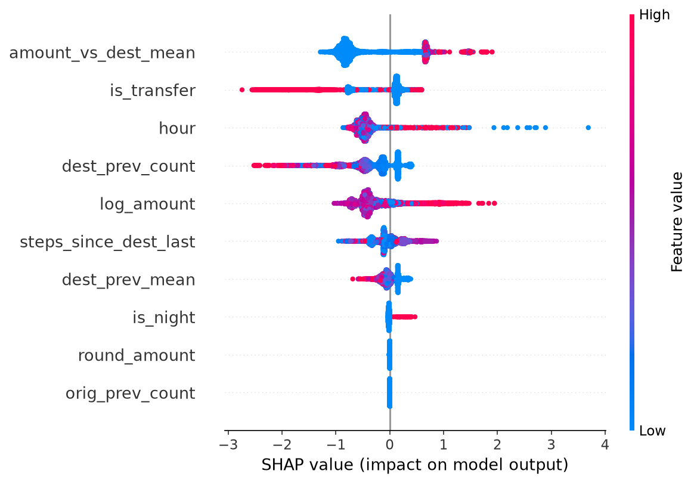
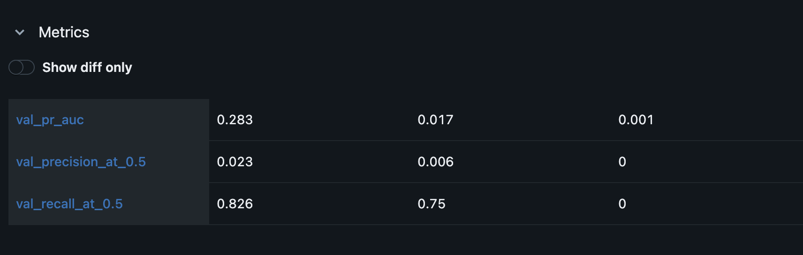

# Real-Time Fraud Detection

[](https://github.com/lakshyaashetty/fraud-detection/actions/workflows/ci.yml)

A fraud model for mobile-money transfers, served as an API that scores a transaction in real time, returns an approve/review decision, and explains each score.

**Headline (held-out test period):** reviewing fewer than 1 in 100 transactions, the model catches **58% of fraud cases and 93% of fraud dollars**, versus 0.19% for the existing rule. About **1 in 8 alerts is real fraud.**

## Results

**Model comparison** (validation; fraud is 0.13% of transactions, so a random guess scores PR-AUC ≈ 0.0013):

| Model | PR-AUC |
|---|---|
| Existing rule (`isFlaggedFraud`) | 0.001 |
| Logistic regression | 0.017 |
| **XGBoost** | **0.283** |

**How much fraud each review budget catches** (validation):

| Review budget | Recall | Precision | Fraud $ caught |
|---|---|---|---|
| 0.2% of transactions | 27.4% | 16.8% | 54.8% |
| 0.5% | 43.8% | 11.0% | 78.5% |
| **1% (chosen)** | **56.4%** | **7.3%** | **88.3%** |
| 2% | 68.4% | 4.5% | 91.5% |
| 5% | 83.0% | 2.2% | 97.3% |

Going from a 1% to a 5% budget (5x the review workload) adds only about 9 points of fraud dollars caught.

**Final results at the 1% operating point:**

| Period | PR-AUC | ROC-AUC | Recall | Precision | Flagged per 1,000 | Fraud $ caught |
|---|---|---|---|---|---|---|
| Validation | 0.283 | 0.941 | 56.4% | 7.3% | 10.1 | 88.3% |
| **Test** | **0.430** | **0.932** | **58.3%** | **12.1%** | **7.5** | **92.9%** |
| Stress (traffic shift) | 0.531 | 0.937 | 58.5% | 38.0% | 23.9 | 90.2% |



## How it works

1. **Data** (`src/data.py`): PaySim transactions, filtered to TRANSFER and CASH_OUT (the only types with fraud), saved as parquet.
2. **Features** (`src/features.py`): amount, transaction type, hour of day, and receiver history (prior payments received, their average, time since the last one). Every feature uses only earlier transactions.
3. **Training** (`src/train.py`): rule baseline, logistic regression, and XGBoost with class weighting and early stopping, tracked in MLflow.
4. **Evaluation** (`src/evaluate.py`): threshold set by review capacity on validation, test scored once, SHAP explanations, error analysis.
5. **Serving** (`app/main.py`, `Dockerfile`): FastAPI endpoint, packaged with Docker, that builds features from live account history, scores the transaction, and returns the top three reasons.
6. **Quality** (`tests/`): pytest suite run by GitHub Actions on every push.



## Key decisions

- **Dropped the four balance columns (data leakage).** Fraudulent transactions are cancelled, so post-transaction balances reveal the label. Many public notebooks use them and report near-perfect scores; those models learn the cancellation, not fraud. Balances after a transaction also don't exist when a fraud model must score it.
- **Split by time, and redesigned the split after checking it.** Fraud arrives at a steady ~11 per hour, but legitimate volume collapses after hour ~400, so later periods had up to 17x the training fraud rate. Main results use hours 1–400 (train 1–300, validation 301–350, test 351–400); hours 401–744 are a separate stress test.
- **Threshold by review capacity, not pure cost.** Minimizing (missed fraud dollars + $25 per review) flagged 60% of all transactions, because a missed fraud costs hundreds of thousands of dollars. The math was right but the policy was unusable: real fraud teams have fixed review capacity.
- **History features on the receiver, not the sender.** Senders appear at most 3 times; receivers up to 75.
- **PR-AUC over accuracy.** With 0.3% fraud, predicting "never fraud" is 99.7% accurate.

## Findings

- **Strongest signals (SHAP):** an amount far above the receiver's usual, early-morning hours, brand-new receivers, and large amounts. `round_amount` and `orig_prev_count` contribute almost nothing.
- **Missed fraud looks like normal activity:** of 576 test frauds, the 240 missed were smaller (median ≈ $200K vs ≈ $1.5M caught), mostly cash-outs, in daytime, to receivers with history. Catching these would need sender-side signals such as device or location.
- **Stress test:** recall held at 58.5% during the traffic shift, but alerts rose to 23.9 per 1,000, more than double the planned budget. A real fraud team would be overloaded, which is why alert volume needs production monitoring.
- **Stable ranking:** ROC-AUC is 0.93–0.94 in every period; PR-AUC rises from validation to stress only because fraud makes up a bigger share in each.

## API

```bash
uvicorn app.main:app --reload   # then open http://localhost:8000/docs
```

```json
// POST /score
{"step": 700, "type": "TRANSFER", "amount": 2500000,
 "nameOrig": "TEST_SENDER_1", "nameDest": "TEST_NEW_RECEIVER_1"}

// Response
{"fraud_score": 0.9931, "decision": "review",
 "top_reasons": [{"feature": "hour", "impact": 2.104},
                 {"feature": "amount_vs_dest_mean", "impact": 1.63},
                 {"feature": "log_amount", "impact": 0.875}]}
```

**A debugging story.** An early test of this exact transaction returned *approve* (0.034). The data said the pattern is fraud 88.8% of the time, and the model scored the 384 real cases at a median of 0.993, so the model wasn't the problem. Root cause: the request had been sent twice, and the API updates account history on every call, so the second time the receiver already "had history" of a $2.5M payment. A production version would update history only after a transaction settles and use unique transaction IDs so retries aren't double-counted. Both behaviors are now covered by tests.

## Run it

```bash
git clone https://github.com/lakshyaashetty/fraud-detection.git
cd fraud-detection
python3 -m venv .venv && source .venv/bin/activate
pip install -r requirements.txt
brew install libomp                     # macOS only, required by XGBoost
kaggle datasets download -d ealaxi/paysim1 -p data/raw --unzip
python -m src.data                      # build the parquet file
python -m src.train                     # train and log to MLflow
python -m src.evaluate                  # threshold, test results, SHAP
python -m src.build_state               # account history for the API
uvicorn app.main:app --reload           # start the API
python -m pytest -v                     # run tests
```

### Or run the API with Docker

```bash
docker build -t fraud-api .
docker run --rm -p 8000:8000 fraud-api   # then open http://localhost:8000/docs
```

## Project structure

```text
app/main.py            FastAPI scoring service
src/data.py            load and filter raw data
src/features.py        batch + live feature code (shared to prevent skew)
src/train.py           baselines and XGBoost, MLflow tracking
src/evaluate.py        threshold, test metrics, SHAP, error analysis
src/build_state.py     account history for live scoring
notebooks/             EDA and feature checks
tests/                 feature and API tests
models/                trained model and account state
docs/                  charts used in this README
```

## Limitations and next steps

- **Simulated data.** Patterns like "fraud goes to brand-new receivers" are likely cleaner than in real payments.
- **Stateful API.** Account history updates on every request; see the debugging story above.
- **No sender-side signals.** Device, location, or login data would help with the fraud the model currently misses.
- **Scores are rankings, not calibrated probabilities**, because class weighting inflates them; the threshold is set by review budget for that reason.
- **Next:** probability calibration, and deploying the container to a cloud service.

## Data

PaySim synthetic mobile-money dataset: E. A. Lopez-Rojas, A. Elmir, S. Axelsson, "PaySim: A financial mobile money simulator for fraud detection" (2016). Available on [Kaggle](https://www.kaggle.com/datasets/ealaxi/paysim1) under CC BY-SA 4.0.
